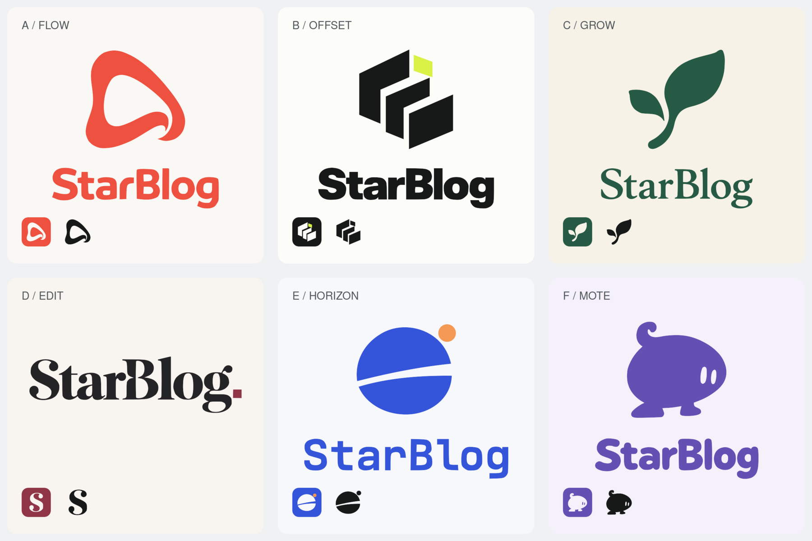

# StarBlog · 六套 Logo 方案

六个方向均已整理为独立、可修改的素材包。当前未选定默认方案，应用中的第一版试装已撤回。下一步可按稳定 ID 接入前台、后台和站点图标。



| 编号 | 稳定 ID | 名称 | 风格 | 素材与规范 |
| --- | --- | --- | --- | --- |
| A | `flow` | 回游 | 珊瑚红、连续曲线、温暖 | [方案目录](./flow/README.md) |
| B | `offset` | 错位 | 黑色与酸柠黄、几何、秩序 | [方案目录](./offset/README.md) |
| C | `grow` | 向生 | 森林绿、有机生长、文艺 | [方案目录](./grow/README.md) |
| D | `edit` | 留白 | 纯字标、衬线字体、编辑感 | [方案目录](./edit/README.md) |
| E | `horizon` | 远岸 | 钴蓝与橙色、抽象远景、清爽 | [方案目录](./horizon/README.md) |
| F | `mote` | 墨团 | 紫色、角色图形、轻松有趣 | [方案目录](./mote/README.md) |

## 每套方案的文件

```text
flow/                       # 其余五套使用相同结构
├── README.md               # 设计说明、配色与使用规范
├── brand.json              # 稳定 ID、配色、尺寸、来源和布局规则
├── concept.png             # 用户认可的原始概念稿
├── prompt.txt              # 原始 ImageGen 提示词
├── source/
│   ├── mark.svg            # 可编辑图形母版
│   └── wordmark.svg        # 已转路径的可编辑字标母版
└── exports/
    ├── logo.svg / .png     # 标准横版；PNG 为透明底 2000 px
    ├── logo-mono.svg       # 单色横版
    ├── logo-reversed.svg   # 深色底反白横版
    ├── logo-stacked.svg    # 竖版；edit 保留纯字标
    ├── wordmark.svg        # 独立字标
    ├── mark.svg / .png     # 独立图形；PNG 为透明底 1024 px
    ├── mark-mono.svg
    ├── mark-reversed.svg
    ├── mark-current.svg    # 供后续内联 SVG 组件使用
    ├── app-icon.svg / .png # 应用图标，PNG 为 512 px
    ├── favicon.ico         # 内含 16 / 32 / 48 / 64 px
    ├── apple-touch-icon.png # 180 px
    ├── build.json          # 母版、生成器与导出内容的 SHA-256
    └── preview.svg / .png  # 横版、深浅色、图标与配色展示
```

主标识均为真实 SVG 路径，导出文件不嵌入位图，也不依赖外部字体。`concept.png` 保留原始探索结果；正式使用和修改以 `source/` 为准。几何图形已规整，曲线已平滑；所有版本共用母版。

原始六张概念稿由内置 ImageGen 工具生成；提示词分别保存在每套方案的 `prompt.txt`。本次整理未重新生成概念图。

## 修改与重新导出

生成工具只使用 Python 3 标准库和 ImageMagick `convert`，不需要 API Key 或网络。它只写入 `docs/brand`，不会选择默认方案或改写应用文件。

```sh
# 查看稳定 ID
python3 scripts/brand-assets.py --list

# 修改 source/ 或 brand.json 后，重新导出一套
python3 scripts/brand-assets.py --scheme flow

# 重建全部素材与六套对照图
python3 scripts/brand-assets.py

# 检查母版与导出是否一致，以及矢量、PNG、ICO 和文档是否齐全
python3 scripts/brand-assets.py --check
```

请将母版、配置和对应导出一起提交。每套方案可以独立演进；不要直接改 `exports/` 后遗漏母版。

## 下一步的切换约定

[manifest.json](./manifest.json) 记录六个稳定 ID，`selected` 目前为 `null`，只表示尚未选择，不是运行时配置。后续接入时使用一处配置选择 ID，让导航、页脚、后台和 favicon 统一读取所选方案；六套源素材持续保存在本目录。

六套导出名称和尺寸已经统一。切换时需要同步处理图形与站点图标；深色底使用 `logo-reversed.svg` 或 `mark-reversed.svg`。`mark-current.svg` 供内联 SVG 使用，作为外部 `` 时不能继承宿主元素颜色。

第一版“星光书页”的素材、提示词、ZIP 和展示板已清理。仓库原有历史图片 `docs/images/logo.jpg` 保留供追溯。
