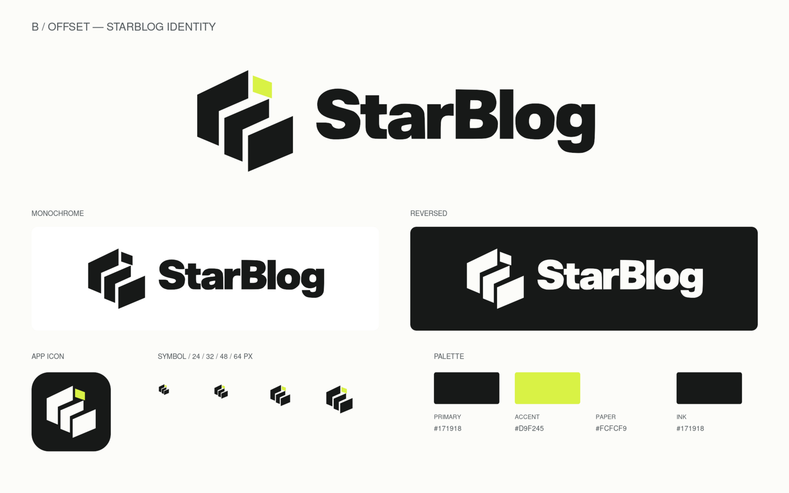

# B · 错位 / OFFSET

三个错位的几何平面形成紧凑轮廓，以酸柠黄角块提供视觉重心。



## 源文件与配色

- [图形母版](./source/mark.svg)：可直接编辑的独立路径。
- [字标母版](./source/wordmark.svg)：沿已认可概念稿的轮廓矢量化，字形为路径，无需安装字体。
- [方案配置](./brand.json)：稳定 ID、配色、最小尺寸和来源记录。
- [原始概念稿](./concept.png)与[完整 ImageGen 提示词](./prompt.txt)：用于追溯及继续探索。概念稿由内置 ImageGen 生成；正式导出由矢量母版生成。

| 色彩角色 | 色值 |
| --- | --- |
| primary | `#171918` |
| accent | `#D9F245` |
| paper | `#FCFCF9` |
| ink | `#171918` |

## 可用素材

| 用途 | 文件 |
| --- | --- |
| 标准横版 | [SVG](./exports/logo.svg) · [透明 PNG，2000 px](./exports/logo.png) |
| 单色 / 反白横版 | [单色 SVG](./exports/logo-mono.svg) · [反白 SVG](./exports/logo-reversed.svg) |
| 竖版组合 | [SVG](./exports/logo-stacked.svg) |
| 独立图形 | [彩色 SVG](./exports/mark.svg) · [单色 SVG](./exports/mark-mono.svg) · [反白 SVG](./exports/mark-reversed.svg) · [透明 PNG，1024 px](./exports/mark.png) |
| 跟随文字颜色 | [currentColor SVG](./exports/mark-current.svg)，供后续内联 SVG 组件使用 |
| 独立字标 | [SVG](./exports/wordmark.svg) |
| 应用图标 | [SVG](./exports/app-icon.svg) · [512 px PNG](./exports/app-icon.png) |
| 浏览器 / 触屏图标 | [ICO，16/32/48/64 px](./exports/favicon.ico) · [180 px PNG](./exports/apple-touch-icon.png) |
| 规范化展示 | [SVG](./exports/preview.svg) · [PNG](./exports/preview.png) |

## 使用与修改

单色版统一角块颜色；彩色版与深色底图标保留角块，避免改变各平面的间隙。

图形建议不小于 24 CSS px，完整组合建议不小于 140 CSS px。浏览器标签使用已留出安全边距的配套 favicon。图形四周保留至少相当于图形宽度 1/4 的外部空白，不拉伸、描边或添加阴影。

修改造型时编辑 `source/` 母版；修改颜色时编辑 `brand.json` 的 `palette` 与 `iconBackground`，然后在仓库根目录运行：

```sh
python3 scripts/brand-assets.py --scheme offset
python3 scripts/brand-assets.py --check --scheme offset
```

完成修改后运行一次不带 `--scheme` 的生成命令，以更新六套对照图。`exports/` 为生成产物，应与源文件一同提交。

此方案已整理备用，尚未选定为应用默认标识。[返回六套方案目录](../README.md)。
